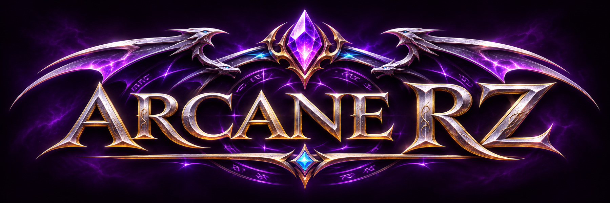

# Arcane RZ

**A familiar world. A project with its own identity.**

Client, server and a native toolchain around **Rappelz** — maintained and developed by **Makenci**.

[Website](https://arcane-rappelz.com/) · [Client & server](#client--server) · [14 tools](#the-toolchain) · [Developer](https://github.com/tomsmulski) · [Deutsch](#deutsch)

---

## Beyond the game world

**Arcane RZ** is dedicated to the technical development of a Rappelz-related project — from client and server work to the editors, resource tools and launcher behind the experience.

### Client & server

<table>
<tr>
<td valign="top" width="50%">
<h3>Client · The world on screen</h3>

Work on the Windows game client, DirectX 11 rendering, native x64 migration and the in-game interface.

<strong>C++ · Windows · Direct3D 11 · HLSL</strong>

</td>
<td valign="top" width="50%">
<h3>Server · The systems behind it</h3>

Work on gameplay systems, Lua scripting, scheduling, networking and database integration in the game server.

<strong>C++ · Windows · Lua · SQL Server</strong>

</td>
</tr>
</table>

### The toolchain

A family of **14 dedicated tools** supports content authoring, resource workflows and development. Many of the modern desktop tools use C++23, Dear ImGui and DirectX 11; individual products retain their own platform and compatibility requirements.

| Tool | Purpose |
| --- | --- |
| **ItemEditor** | Item resources, attributes and effects. |
| **SkillEditor** | Skills, effects and related authoring workflows. |
| **MonsterEditor** | Monster resources and model-based editing. |
| **DropEditor** | Drop relationships, loot analysis and visual workflows. |
| **QuestEditor** | Quests, links, pools and associated text resources. |
| **MapTool** | Terrain, props, water, events and movement paths. |
| **NUI Studio** | In-game interface layouts, sprites and control templates. |
| **AssetStudio** | Native models, animation, effects and texture previews. |
| **RDBTool · Arcane Edition** | SQL/RDB resource import, export and checking. |
| **ClientForge** | Browsing, extracting and rebuilding client archives. |
| **ItemShopEditor** | Editing the in-game shop catalogue. |
| **AdminUserTool** | Read-only inspection of account, character and related data. |
| **BuildManager** | Build workflows, queues, history and reports. |
| **Arcane Launcher** | Game startup, downloads, patching, repair and self-update. |

**Development is ongoing.** Source changes, compiled builds and practical validation are separate milestones. This overview does not claim that every component is fully tested, publicly downloadable or available as a live service.

### Project identity & source access

**Arcane RZ is an independent Rappelz-related project, not an official Rappelz organisation.** Rappelz and its original content belong to their respective rights holders. The Arcane identity describes this project and its own work; it does not claim ownership of the original game.

**Project repositories remain private.** This public profile is an introduction, not a distribution of game files, credentials or source code.

---

## Deutsch

### Eine bekannte Welt. Ein eigener Projektauftritt.

**Arcane RZ** steht für die technische Weiterentwicklung eines Projekts rund um Rappelz – von Client und Server bis zu den Editoren, Ressourcenwerkzeugen und dem Launcher dahinter.

### Client und Server

**Client:** Weiterentwicklung des Windows-Spielclients mit DirectX-11-Rendering, nativer x64-Migration und Arbeit an der Ingame-Oberfläche. Technische Grundlage: C++, Direct3D 11 und HLSL.

**Server:** Arbeit an Spielsystemen, Lua-Skripting, Zeitplanung, Netzwerkverarbeitung und Datenbankanbindung. Technische Grundlage: C++, Windows, Lua und SQL Server.

### 14 Werkzeuge für die Arbeit dahinter

| Werkzeug | Aufgabe |
| --- | --- |
| **ItemEditor** | Gegenstände, Attribute und Effekte bearbeiten. |
| **SkillEditor** | Fähigkeiten, Effekte und zugehörige Bearbeitungsabläufe. |
| **MonsterEditor** | Monsterressourcen und modellbasierte Bearbeitung. |
| **DropEditor** | Drop-Beziehungen, Beuteanalysen und visuelle Arbeitsabläufe. |
| **QuestEditor** | Quests, Verknüpfungen, Pools und zugehörige Texte. |
| **MapTool** | Gelände, Objekte, Wasser, Ereignisse und Bewegungspfade. |
| **NUI Studio** | Ingame-Oberflächen, Sprites und Bedienelement-Vorlagen. |
| **AssetStudio** | Modelle, Animationen, Effekte und Texturen ansehen und bearbeiten. |
| **RDBTool · Arcane Edition** | SQL-/RDB-Ressourcen importieren, exportieren und prüfen. |
| **ClientForge** | Clientarchive durchsuchen, entpacken und neu aufbauen. |
| **ItemShopEditor** | Den Katalog des Ingame-Shops bearbeiten. |
| **AdminUserTool** | Konten, Charaktere und zugehörige Daten lesend untersuchen. |
| **BuildManager** | Builds, Warteschlangen, Verlauf und Berichte verwalten. |
| **Arcane Launcher** | Spielstart, Downloads, Patches, Reparatur und Selbstaktualisierung. |

Viele moderne Desktop-Tools setzen auf **C++23, Dear ImGui und DirectX 11**. Einzelne Programme behalten ihre eigenen Plattform- und Kompatibilitätsvorgaben.

**Das Projekt wird weiterentwickelt.** Quelländerung, gebautes Programm und praktische Prüfung sind unterschiedliche Stände. Die Übersicht verspricht weder vollständige Abnahme aller Komponenten noch öffentliche Downloads oder einen verfügbaren Spielbetrieb.

**Arcane RZ ist ein unabhängiges Rappelz-bezogenes Projekt und keine offizielle Rappelz-Organisation.** Rappelz und die ursprünglichen Spielinhalte gehören den jeweiligen Rechteinhabern. Der eigene Projektauftritt begründet kein Eigentum am Originalspiel.

**Alle Projekt-Repositories bleiben privat.** Hier werden keine Spieldateien, Zugangsdaten oder privaten Quellen veröffentlicht.

**Client. Server. Werkzeuge. Ein eigener Projektcharakter.**

[arcane-rappelz.com](https://arcane-rappelz.com/) · [Makenci auf GitHub](https://github.com/tomsmulski)

